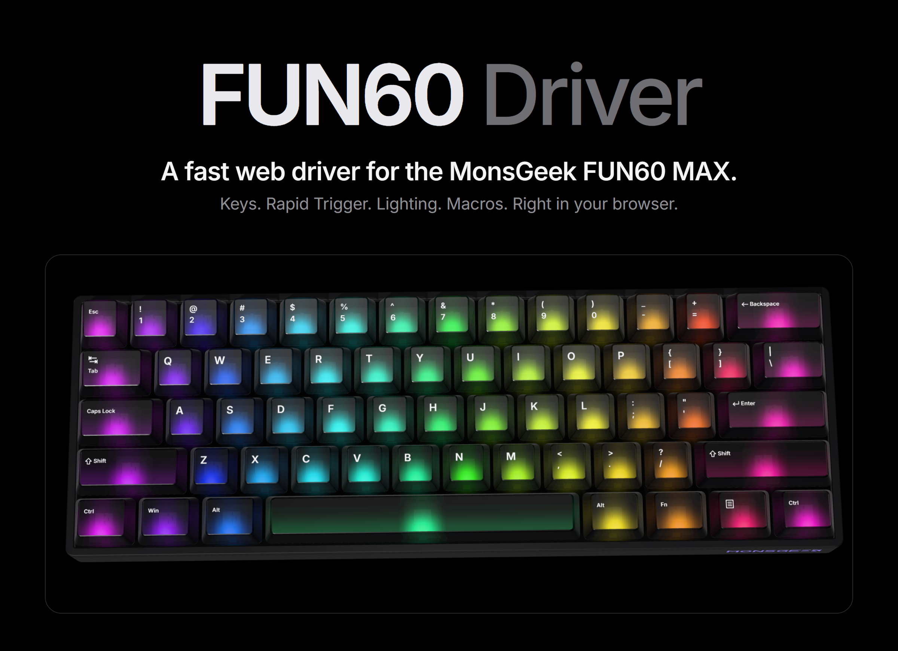
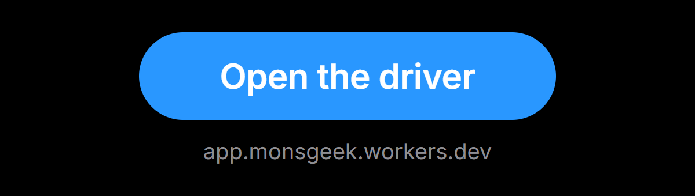
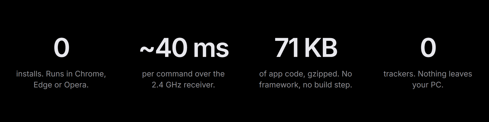
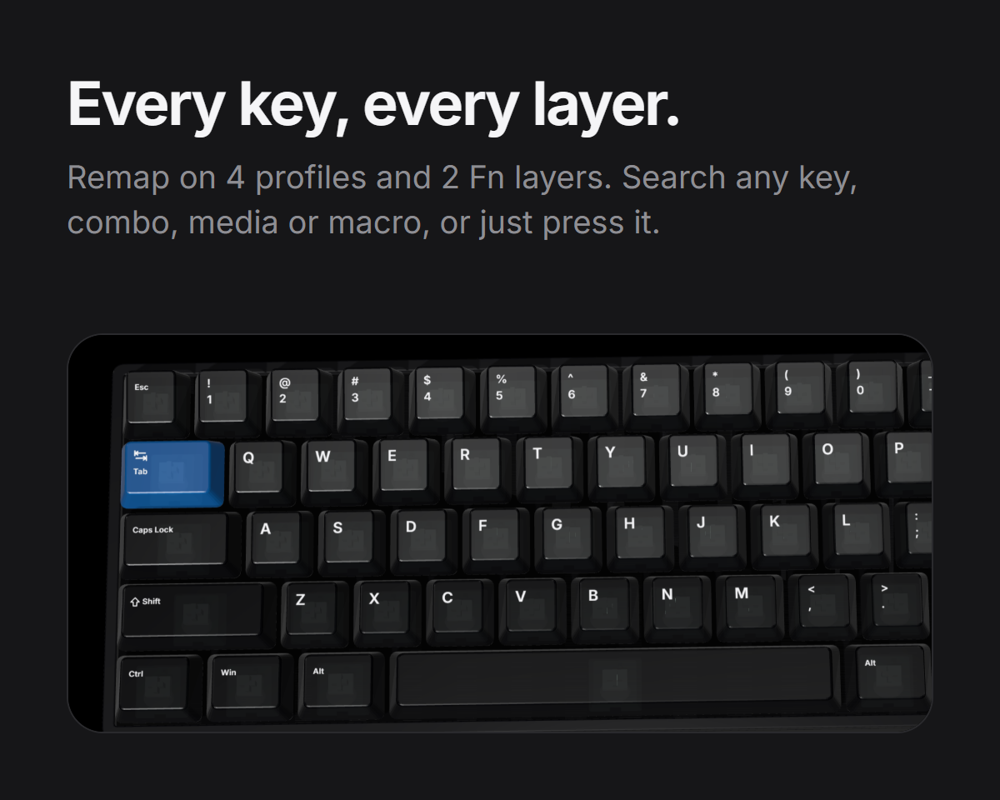
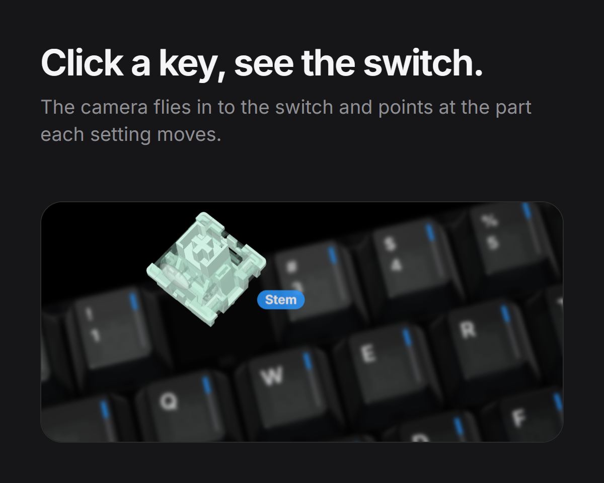
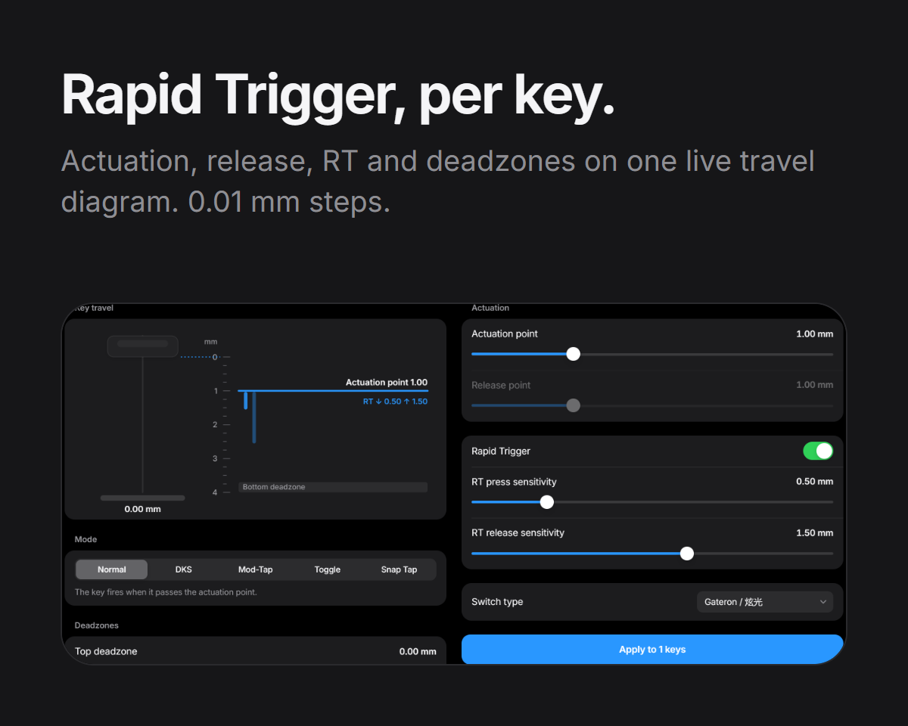
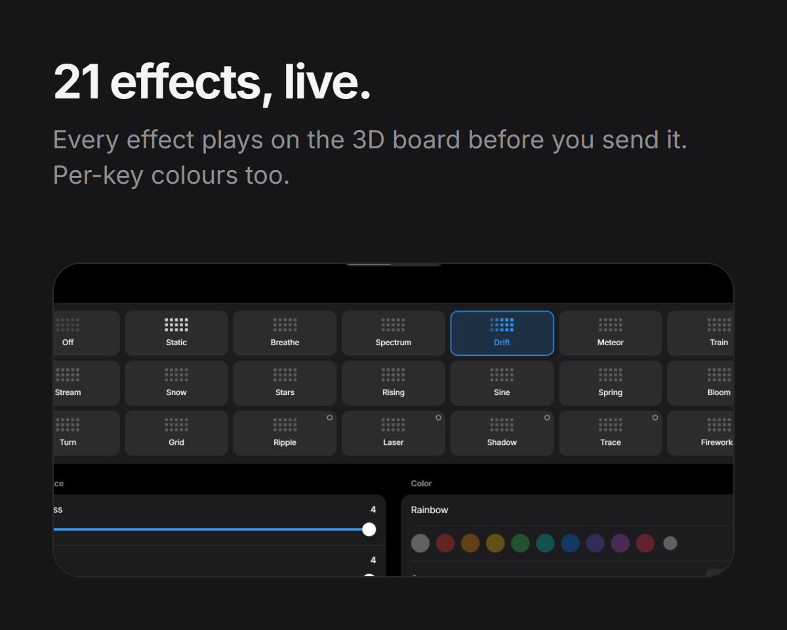
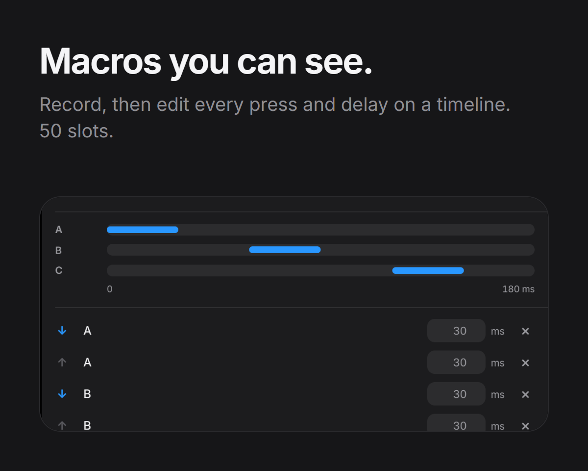
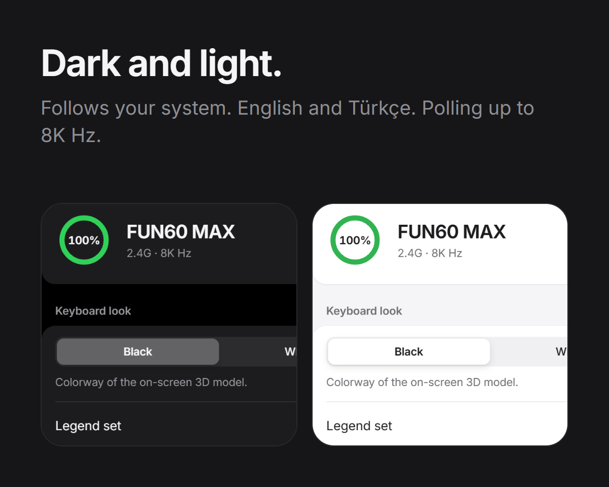
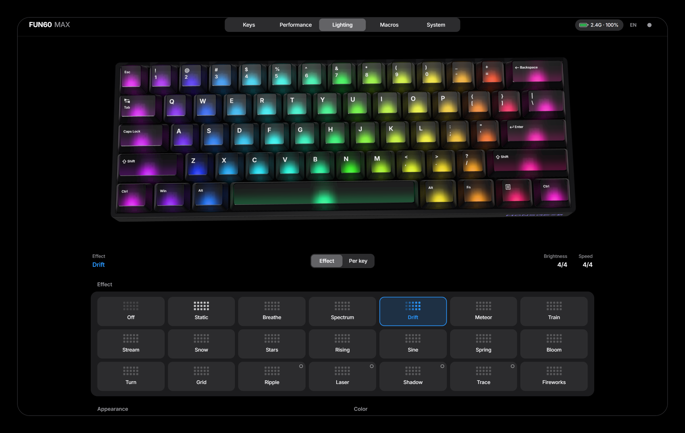

<div align="center">



<br>

<a href="https://app.monsgeek.workers.dev"></a>

<sub>Chrome, Edge or Opera on desktop · USB cable or 2.4 GHz receiver · nothing to install</sub>

</div>

<br>



<br>

## Everything the keyboard can do

<table>
<tr>
<td width="50%"></td>
<td width="50%"></td>
</tr>
<tr>
<td width="50%"></td>
<td width="50%"></td>
</tr>
<tr>
<td width="50%"></td>
<td width="50%"></td>
</tr>
</table>

<br>

## A real 3D board

<p align="center">
  
</p>

The keyboard on screen is a WebGL model of the FUN60 MAX, built in code with three.js: tray case, Cherry-profile caps with per-row height and angle, translucent caps with the switches visible, and south-facing per-key LEDs. Lighting effects play on it before you send them. Drag to turn it, double-click to reset. Without WebGL2 a CSS board takes its place.

<br>

## Use it

1. **Open** [app.monsgeek.workers.dev](https://app.monsgeek.workers.dev) in Chrome, Edge or Opera.
2. **Plug in** the receiver or the USB cable and press **Connect**. Pick the keyboard in the browser's list.
3. **Done.** Next time it reconnects on its own.

Bluetooth is not supported. Close the vendor app first so the two do not talk to the keyboard at the same time.

<br>

## What you can do

| | |
|---|---|
| **Keys** | Remap on 4 profiles and 2 Fn layers. See what the selected key does on every layer. Searchable picker for keys, combos (up to 2 modifiers), media, mouse, system, connection, lighting and macro actions, or assign a key by pressing it. |
| **Performance** | A live travel diagram shows actuation, release, Rapid Trigger and both deadzones, per key, in 0.01 mm steps. DKS (4 actions × 4 stages), Mod-Tap, Toggle, Snap Tap and switch type. Click a key and the camera flies in to its switch; drag-select in multi-select mode. *Live view* streams real key travel. |
| **Lighting** | 21 effects previewed on the 3D board (an approximation of the firmware animation). Brightness, speed, direction, colour or rainbow. 5 per-key patterns you paint by clicking keys. |
| **Macros** | 50 slots. Record from the keyboard, edit every press and delay on a timeline, set a repeat count, then assign to a key as repeat N, toggle or while held. |
| **System** | Polling rate up to 8K Hz, sleep timers, WASD/arrow swap, FalseTouch guard, RT stabilizer, device info, travel calibration with per-key progress, factory reset, and the look of the 3D board (colorway, TR Q or US legends, top or front print). |

<br>

## Fast on purpose

- **About 40 ms per command** over the 2.4 GHz receiver. The vendor app sleeps a fixed ~100 ms at each step of the relay, so a command takes about 250 ms there. This driver polls the receiver's status instead. A full keymap read (8 pages) takes about 300 ms.
- **Small.** Plain ES modules, no framework, no build step: 71 KB gzipped for all app JS, CSS and HTML. three.js (vendored) loads after the first paint.
- **Static.** It is a folder of files. On Cloudflare it runs as a static-assets Worker on the free plan: no script runs per request.

## Privacy

The page talks only to your keyboard (WebHID) and to the server it came from. No analytics, no trackers, no accounts. The CSP in `public/_headers` blocks every other origin. Settings for the page (theme, language, last tab) stay in your browser's local storage.

## Run it yourself

```bash
node dev.mjs
```

Open http://localhost:8787. Add `?demo` to try the interface against a built-in emulator with no keyboard attached.

Deploy to Cloudflare (free plan):

```bash
npx wrangler@4 deploy
```

`wrangler.toml` deploys `public/` as a static-assets Worker. `public/_headers` sets the CSP, the `hid` permissions policy and the cache rules.

The pictures above are real screenshots of `?demo`, taken with headless Chrome.

<details>
<summary><b>Protocol notes</b></summary>

<br>

All traffic is 64-byte feature reports (report ID 0) on the vendor interface (usage page `0xFFFF`, usage `0x02`). Byte 7 holds `255 - (sum(bytes 0..6) & 255)`. The light command (`0x07`) is the exception: it puts the checksum in byte 8 over bytes 0..7.

Receiver relay: `F7` → status (`[0]` can read, `[1]` battery, `[3]==0` online, `[5]` can send, `[6]` device kind). `F6 0A` routes to the keyboard. `FC` fetches the keyboard reply into the next GET_FEATURE.

| Get | Set | Meaning |
| --- | --- | --- |
| `8F` | – | device id (u32 LE @1), firmware (u16 LE @7) |
| `84` | `04` | active profile |
| `83` | `03` | polling rate index (8k…125) |
| `87` | `07` | lighting: mode, 4−speed, brightness, option<<4 \| flag, RGB |
| `89` | `09` | options: fn index, FalseTouch, RT stab/25, WASD swap |
| `91` | `11` | sleep timers (u16 LE @8,10,12,14, seconds) |
| `8A` | `0A` | keymap `[profile, 0xFF, page, layer]`, 4 bytes per matrix slot |
| `90` | `10` | Fn layer `[os, layer, 0xFF, page]` |
| `8B` | `0B` | macro pages |
| `8C` | `0C` | per-key RGB pattern (126 × RGB) |
| `E5` | `65` | HE per-key arrays by op: 0 actuation, 1 release, 2/3 RT, 4 DKS travel, 5 MT time, 6 bottom DZ, 7 mode, 8 DKS stages, 9 Snap partner, 10 DKS stage table, 251 top DZ, 252 switch, 254 live travel |
| – | `1C`/`1E` | calibration (rest / bottom-out) |
| – | `01` | factory reset |

</details>

<details>
<summary><b>Known gaps</b></summary>

<br>

- Some Fn-layer function names are inferred from the factory layout: the `13.x` lighting keys, the `14.x` connection keys and the meaning of each DKS stage value. The bytes written are correct, but a label may be wrong.
- Only the Windows Fn layers are editable. The Mac Fn layers are read-only firmware defaults.
- Audio- and screen-reactive lighting modes are left out because they need a host-side helper.

</details>

## License

[MIT](LICENSE). three.js (`public/vendor`) is MIT, Inter (`public/fonts`) is SIL OFL 1.1.

Unofficial. Not made by or affiliated with MonsGeek or Akko. Product names and logos belong to their owners.

---

# Türkçe

**FUN60 Driver**, MonsGeek / Akko FUN60 MAX (manyetik HE switch, RY5088) için hızlı bir web sürücüsü. Tarayıcıda WebHID ile klavyeyle doğrudan konuşur; kurulum, hesap ya da arka planda çalışan bir program yok.

**Kullanım:** Chrome, Edge ya da Opera'da [app.monsgeek.workers.dev](https://app.monsgeek.workers.dev) adresini aç, alıcıyı ya da USB kablosunu tak, **Bağlan**'a bas ve listeden klavyeyi seç. Sonraki açılışta kendiliğinden bağlanır. Bluetooth desteklenmez. Önce üreticinin uygulamasını kapat ki ikisi klavyeyle aynı anda konuşmasın.

**Hız:** 2.4 GHz alıcı üzerinden komut başına yaklaşık 40 ms. Üreticinin uygulaması her adımda sabit ~100 ms beklediği için orada bir komut ~250 ms sürer. Tüm tuş haritası (8 sayfa) ~300 ms'de okunur.

| | |
|---|---|
| **Tuşlar** | 4 profil ve 2 Fn katmanında tuş atama. Seçili tuşun her katmanda ne yaptığı görünür. Tuş, kombinasyon (en çok 2 değiştirici), medya, fare, sistem, bağlantı, ışık ve makro için aranabilir seçici; ya da tuşa basarak ata. |
| **Performans** | Canlı tuş yolu şeması: tetikleme, bırakma, Rapid Trigger ve iki ölü bölge, tuş başına, 0,01 mm adımla. DKS (4 eylem × 4 kademe), Mod-Tap, Toggle, Snap Tap ve switch tipi. Bir tuşa tıklayınca kamera o tuşun switch'ine uçar; çoklu seçimde sürükleyerek seç. *Canlı görünüm* gerçek tuş yolunu akıtır. |
| **Işık** | 21 efekt, 3D klavyede canlı önizleme (firmware animasyonunun yaklaşık hali). Parlaklık, hız, yön, renk ya da gökkuşağı. Tuşlara tıklayarak boyadığın 5 tuş başı desen. |
| **Makro** | 50 yuva. Klavyeden kaydet, her basışı ve gecikmeyi zaman çizelgesinde düzenle, tekrar sayısını ayarla; N kez, aç/kapa ya da basılı tutunca olarak bir tuşa ata. |
| **Sistem** | 8K Hz'e kadar polling, uyku süreleri, WASD/ok değişimi, FalseTouch koruması, RT dengeleyici, cihaz bilgisi, tuş başı ilerlemeli kalibrasyon, fabrika ayarları ve 3D klavyenin görünümü (renk, TR Q ya da US baskı, üst ya da ön baskı). |

**Gizlilik:** Sayfa yalnızca klavyenle (WebHID) ve geldiği sunucuyla konuşur. Analitik, izleyici ya da hesap yok.

**Kendin çalıştır:** `node dev.mjs`, sonra http://localhost:8787 (klavyesiz denemek için `?demo` ekle). Cloudflare'e ücretsiz planda yüklemek için `npx wrangler@4 deploy`.

Resmi değildir; MonsGeek ya da Akko ile bağlantısı yoktur. Lisans: [MIT](LICENSE).
